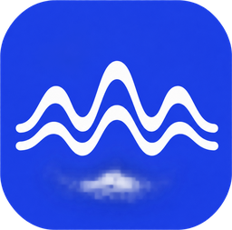

<h1 align="center">Sonora</h1>

Contexto acústico para quem compara lugares para morar em São Paulo.

<a href="https://peguidotte.github.io/sonora/"><strong>Conheça o Sonora</strong></a> · <a href="https://peguidotte.github.io/sonora/api-docs.html">Explore a API</a> · <a href="https://sonora-gs-58403f1647.centralus.cloudapp.azure.com/dashboard">Abra o painel</a>

Uma visita a um imóvel dura minutos. O Sonora permite consultar o ruído observado em diferentes horários e informa a origem dos dados e quanto tempo foi medido. Portais imobiliários podem integrar essa consulta pela API privada. Quando não há medições para um período, o resultado indica **sem dados**.

## Explore o projeto

| Disciplina | O que você encontra | Responsável |
| --- | --- | --- |
| [Physical Computing · IoT](iot/README.md) | Circuito ESP32, simulação no Wokwi e vídeo | Leonardo |
| [SOA e Web Services](soa/README.md) | Ingestão Java, importação NoiseCapture e [migrations](database/README.md) | Felipe |
| [C# Software Development](api/README.md) | Consulta acústica, painel e documentação da API | Leonardo |
| [Mobile Development](mobile/README.md) | Consulta e comparação de locais pelo celular | Herbert |
| [IA e Machine Learning](ml/README.md) | Perfis aprendidos em medições públicas, notebook e vídeo | Gabriel |
| [Operating Systems · Linux](linux/README.md) | Servidor, automação Bash, monitoramento e demonstração | Pedro |
| [Cybersecurity](cybersecurity/README.md) | Auditoria de dados pessoais, painel, PDF e vídeo | Herbert |
| [Testing, Compliance & QA](testing/README.md) | Critérios de aceite, casos funcionais e entrega do pitch | Felipe |

## Como uma leitura chega ao cidadão

O serviço Java recebe janelas acústicas do ESP32 simulado e importa arquivos públicos do NoiseCapture. Grava os dados no PostgreSQL com a origem de cada medição. A API C# lê as views do banco e calcula os perfis que o painel e o app consultam. As consultas preservam a distinção entre simulação e dados públicos. O Sonora não armazena áudio.

Para desenvolver, comece pelo README da sua matéria. As interfaces ficam nos [contratos](contracts/README.md), as decisões de integração na [arquitetura](docs/arquitetura.md) e a publicação no [guia de deploy](deploy/azure/README.md). Veja também as [rubricas](docs/disciplinas/README.md) e o [fluxo de contribuição](CONTRIBUTING.md).

## Equipe

Global Solution CitizenTech · Engenharia de Software · FIAP Paulista · 3ESPV 2026

| Integrante | RM |
| --- | --- |
| Leonardo Correa de Mello | 555573 |
| Felipe Soares Xavier | 556931 |
| Pedro Visconti Guidotte | 556630 |
| Herbert de Sousa Vilela | 555701 |
| Gabriel Figueira Flora | 556476 |
