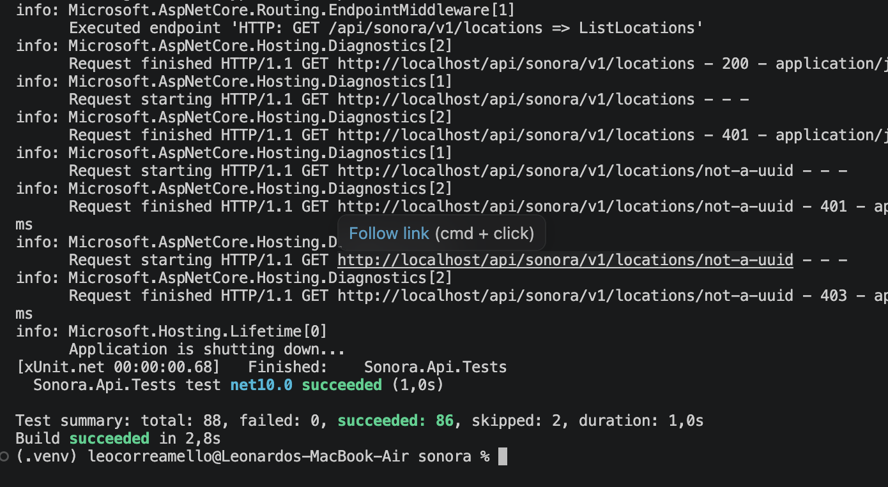
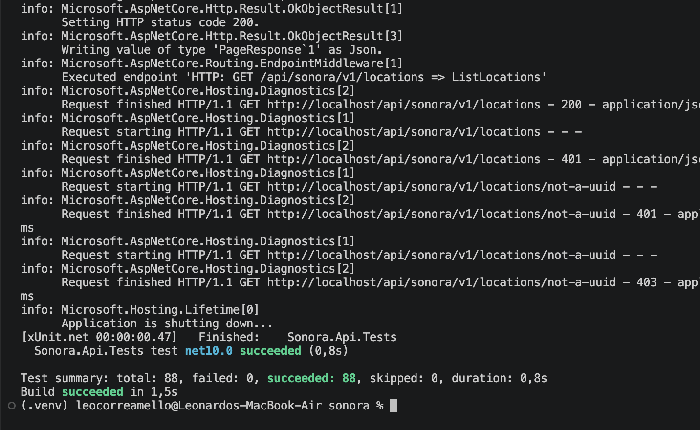
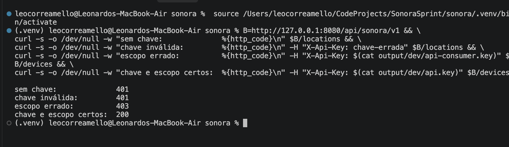
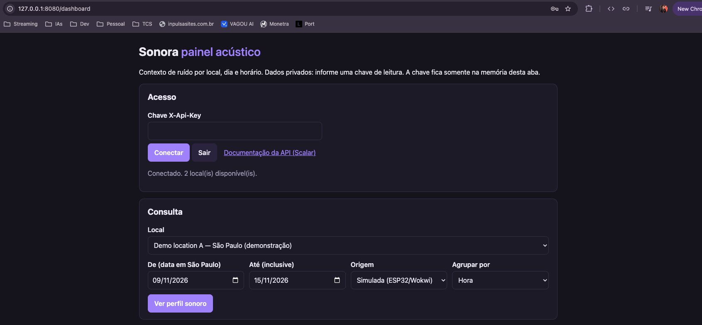
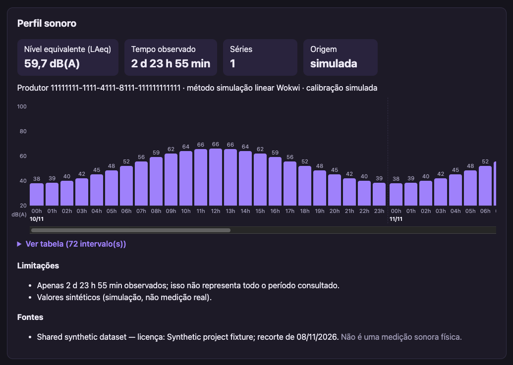
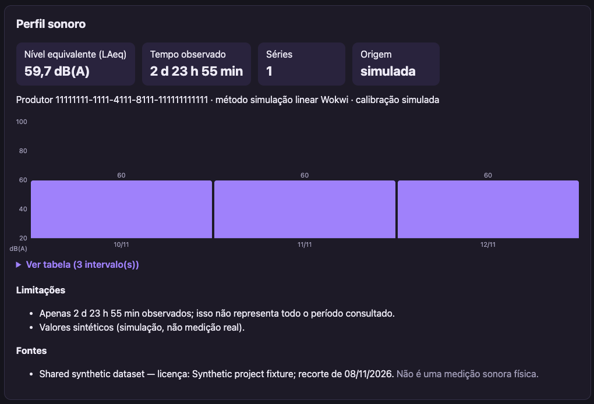
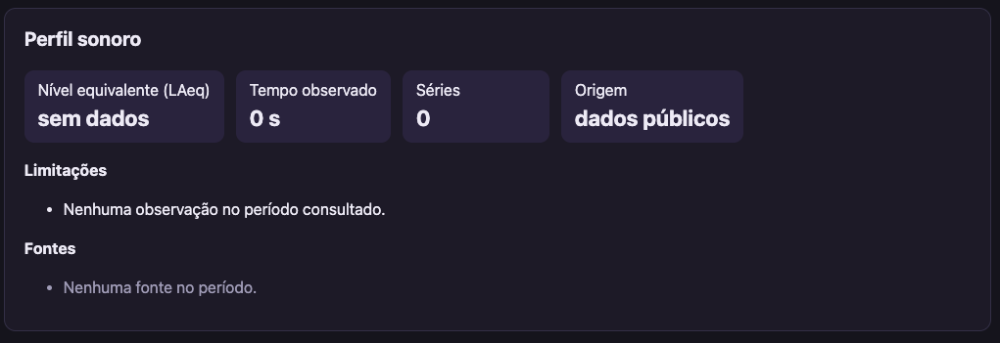
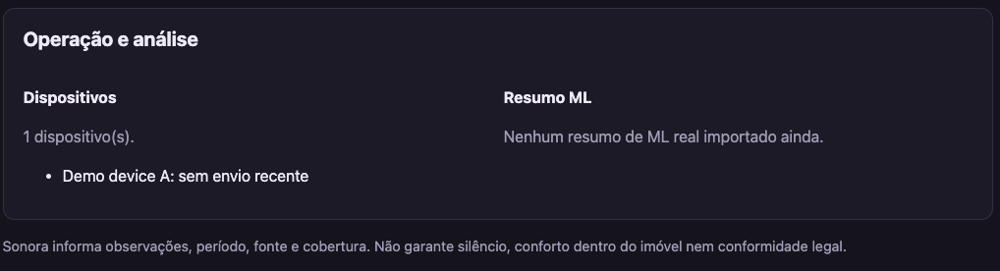
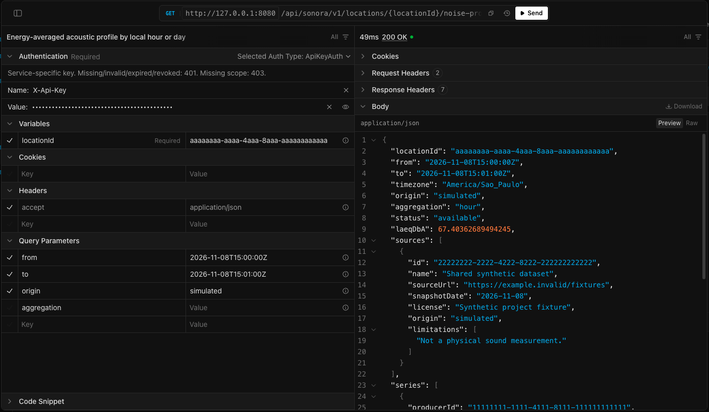
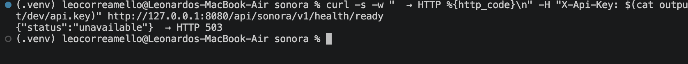

# API de consulta acústica · C#

Compare locais e horários por nível sonoro, cobertura e origem da medição.

[Abrir painel na Azure](https://sonora-gs-58403f1647.centralus.cloudapp.azure.com/dashboard) · [Consultar as rotas](https://sonora-gs-58403f1647.centralus.cloudapp.azure.com/dashboard/docs) · [Executar localmente](#executar)

Responsável: **Leonardo Correa de Mello, RM555573** (C# Software Development).

Equipe: Leonardo Correa de Mello (RM555573), Felipe Soares Xavier (RM556931), Pedro Visconti Guidotte (RM556630), Herbert de Sousa Vilela (RM555701) e Gabriel Figueira Flora (RM556476). Responsabilidades e branches no [README principal](../README.md#equipe).

[Especificação da matéria](../docs/disciplinas/csharp.md) · [Arquitetura](../docs/arquitetura.md) · [Contratos](../contracts/README.md) · [OpenAPI alvo](../contracts/openapi/csharp.openapi.json)

## Guia de avaliação (C# Software Development)

| Entregável pedido | Onde está |
| --- | --- |
| Projeto C# e Web API | [`Sonora.Api/`](Sonora.Api): Minimal API .NET 10; rotas em [`Http/SonoraEndpoints.cs`](Sonora.Api/Http/SonoraEndpoints.cs) |
| Entity Framework Core + LINQ | [`SonoraReadContext.cs`](Sonora.Api/SonoraReadContext.cs) e [`Data/EfAcousticReadStore.cs`](Sonora.Api/Data/EfAcousticReadStore.cs) |
| README com execução e descrição | Este arquivo: [O que a aplicação faz](#o-que-a-aplicação-faz) e [Executar](#executar) |
| Documentação dos endpoints | Scalar em `/dashboard/docs` com a API rodando ([captura 9](docs/evidencias/09-scalar.png)); [tabela de rotas](#rotas-apisonorav1); OpenAPI em [`contracts/openapi/csharp.openapi.json`](../contracts/openapi/csharp.openapi.json) |
| Evidências da aplicação | [Evidências](#evidências): 10 capturas e resultados da integração real |
| Testes unitários e de integração | [`Sonora.Api.Tests/`](Sonora.Api.Tests) e a seção [Testes](#testes) |
| Critérios da rubrica (POO, Web API, EF Core + LINQ, async/await, qualidade) | [Organização e rubrica](#organização-e-rubrica): cada critério ligado aos arquivos |

## O que a aplicação faz

Imobiliárias e pessoas escolhendo onde morar não conseguem perceber, numa visita, o barulho de um endereço ao longo da semana. A API Sonora consulta observações acústicas persistidas pelo serviço Java (sensores ESP32/Wokwi simulados e arquivos públicos NoiseCapture) e entrega **perfis por local, dia e horário**, sempre informando origem, método, cobertura e limitações.

- Somente leitura: lê as views `sonora_read` do PostgreSQL compartilhado com o papel `sonora_query`. Não recebe IoT, não importa lotes e não executa migrations.
- Calcula o nível equivalente por **média energética ponderada pela duração** (`LAeq = 10·log10(Σ dᵢ·10^(Lᵢ/10) / Σ dᵢ)`), nunca média aritmética de dB. Exemplo do aceite: 60 dB e 70 dB em janelas iguais resultam em ≈ 67,40 dB.
- Agrupa por hora ou dia no fuso `America/Sao_Paulo`, fatia observações nos limites dos bins, não conta sobreposição como tempo extra e separa séries por produtor/método/calibração.
- Ausência de dados é `status=no_data` com `laeqDbA: null`, nunca 0 dB.
- API privada por `X-Api-Key` com escopos; painel web e documentação Scalar sem dados embutidos.

## Rotas (`/api/sonora/v1`)

| Rota | Escopo | Descrição |
| --- | --- | --- |
| `GET /health/live` | anônimo | Processo vivo |
| `GET /health/ready` | `operations:read` | Banco e views publicadas acessíveis; 503 se não |
| `GET /locations` | `acoustics:read` | Locais paginados; `latitude`+`longitude`+`radiusMeters` (até 1000 m) adicionam `distanceMeters` |
| `GET /locations/{locationId}` | `acoustics:read` | Um local |
| `GET /locations/{locationId}/noise-profile` | `acoustics:read` | Perfil por `hour`/`day`; `from` inclusivo, `to` exclusivo (UTC com Z, até 31 dias) e `origin` obrigatórios |
| `GET /locations/{locationId}/observations` | `acoustics:read` | Observações persistidas de uma origem, paginadas |
| `GET /devices` | `operations:read` | Dispositivos com estado `recent`/`stale`/`never_seen` calculado do último recebimento IoT |
| `GET /analytics/summary` | `acoustics:read` | Último resumo ML importado; 204 sem artefato real |
| `GET /openapi.json` | `operations:read` | Documento OpenAPI gerado pela aplicação |

Fora do prefixo: `GET /dashboard` (painel) e `GET /dashboard/docs` (Scalar), ambos shells anônimos que pedem a chave e a mantêm apenas na memória da aba.

Erros seguem o schema `Error` do contrato: `400 invalid_parameter|missing_parameter|invalid_window|invalid_coordinates`, `401 unauthorized`, `403 forbidden`, `404 not_found`, `503 service_unavailable`, `500 internal_error` (sem detalhes internos).

## Integração com as outras matérias

A API não chama nenhum outro serviço: tudo passa pelo PostgreSQL (escrito pelo Java) ou pelo HTTP de leitura (consumido pelos clientes). Formatos oficiais em [contracts/](../contracts/README.md); abaixo, só o que cada integração precisa saber do lado C#.

| Matéria | Como se conecta | O que precisa do C# |
| --- | --- | --- |
| SOA (Felipe) | Publica as views `sonora_read`, os grants de `sonora_query` e o seed no [módulo database/](../database/README.md); o Java grava, o C# só lê | Views, colunas e nulabilidade de [database.json](../contracts/database.json), conferidas por `DatabaseContractTests`. Pedido em aberto: expor `producer_id` em `observations` |
| Mobile (Herbert) | Consome só esta API por HTTPS; desenvolve contra o mock (`tools/mock_server.py --service csharp`) e troca a URL base para integrar | Chave com `acoustics:read` digitada pelo usuário e mantida em memória; rotas `locations`, `locations/{id}` e `noise-profile`. Comparar dois locais = dois perfis com a mesma origem e o mesmo período, exibindo as limitações de cada um. App nativo não depende de CORS; a API não habilita CORS para navegador |
| Cybersecurity (Herbert) | Audita a versão identificada desta pasta | Chaves por hash SHA-256 em arquivo fora do Git, escopos, `expiresAt`/`revoked`, 401 antes de 403, papel de banco sem escrita, cabeçalhos `nosniff`/`no-store` e CSP do painel; código em [Security/](Sonora.Api/Security) |
| ML (Gabriel) | Exporta `ml/output/summary.json`; o Java importa para `ml_summaries` | `GET /analytics/summary` devolve o payload mais recente sem alterá-lo, ou 204 se não houver artefato real |
| Testing (Felipe) | Casos no Azure contra as URLs e status do OpenAPI | F01 `locations`; F02 `noise-profile` (60/70 dB → ≈ 67,40; vazio → `no_data`); F03 dois `noise-profile`; F05 observação gravada pelo Java aparece em `observations`/`noise-profile`; F07 `devices` e `health/ready`; F08 `analytics/summary` |
| Linux (Pedro) | Publica o binário e o executa como serviço atrás do proxy HTTPS | Seção [Deploy](#deploy-handoff-para-linux): publish, variáveis, porta, healthcheck e permissões |
| Physical Computing (Leonardo) | ESP32/Wokwi envia ao Java, nunca ao C# | Observações `simulated` com método `wokwi_linear_demo` aparecem nos perfis com a limitação "valores sintéticos" |

## Organização e rubrica

```text
Sonora.Api/
  Domain/        regras puras: TimeWindow, EnergyAverage, AcousticSample, SeriesKey, binning, perfil, GeoPoint, estado do dispositivo
  Data/          linhas das views, IAcousticReadStore e EfAcousticReadStore (LINQ assíncrono)
  Application/   DTOs do contrato e AcousticQueryService (casos de uso)
  Http/          endpoints Minimal API, parsing estrito de parâmetros, painel e Scalar
  Security/      IApiKeyStore/FileApiKeyStore e ApiKeyMiddleware (401/403 por escopo)
  Dashboard/     HTML/CSS/JS do painel, embutidos no assembly
  SonoraReadContext.cs  mapeamento EF Core das views sonora_read
Sonora.Api.Tests/       unitários de domínio, contrato HTTP, segurança, mapeamento EF e integração PostgreSQL
```

| Critério (pontos) | Onde está |
| --- | --- |
| POO (3,0) | Objetos de valor imutáveis com invariantes ([TimeWindow](Sonora.Api/Domain/TimeWindow.cs), [GeoPoint](Sonora.Api/Domain/GeoPoint.cs), [AcousticSample](Sonora.Api/Domain/AcousticSample.cs)); encapsulamento do cálculo em [EnergyAverage](Sonora.Api/Domain/EnergyAverage.cs); herança com função real em [CalendarBinning → HourlyBinning/DailyBinning](Sonora.Api/Domain/Binning.cs) (estratégia polimórfica); [NoiseProfileCalculator](Sonora.Api/Domain/NoiseProfileCalculator.cs) com acumuladores privados |
| Web API (2,5) | [SonoraEndpoints](Sonora.Api/Http/SonoraEndpoints.cs) (rotas, status, DTOs, metadados OpenAPI), [QueryParser](Sonora.Api/Http/QueryParameters.cs) (validação com erro do contrato), tratamento global em [Program.cs](Sonora.Api/Program.cs), documentação Scalar |
| EF Core + LINQ (1,5) | [SonoraReadContext](Sonora.Api/SonoraReadContext.cs) (`ToView`, chaves, `jsonb`, convenção snake_case, escrita bloqueada) e [EfAcousticReadStore](Sonora.Api/Data/EfAcousticReadStore.cs) (filtros, projeções, ordenação, `Skip/Take`, `Count`, `Contains`) |
| Async/await (1,0) | Toda I/O é assíncrona com `CancellationToken` da requisição: consultas EF, leitura do arquivo de chaves, endpoints |
| Qualidade (2,0) | Interfaces nos limites (`IAcousticReadStore`, `IAcousticQueryService`, `INoiseProfileCalculator`, `IBinningStrategy`, `IDeviceStatePolicy`, `IApiKeyStore`) registradas por DI; `TimeProvider` injetado; testes; sem segredos no código |

## Executar

Pré-requisitos: SDK .NET 10 (`dotnet --version` ≥ 10.0), Docker Compose e Python 3.12+ para o banco descartável do [módulo database/](../database/README.md).

1. Banco local. Na raiz do clone, seguir o [README do database/](../database/README.md): `prepare.py`, `docker compose ... up` e `run --rm migrate`. Isso aplica as migrations oficiais (V1–V3, com as views `sonora_read` do SOA) em `127.0.0.1:55432`. Para ter dados, aplicar também o seed sintético: `docker compose -p sonora-local -f database/compose.yaml run --rm -e SONORA_ALLOW_DEV_SEED=1 migrate seed`. Sem as views, `health/ready` responde 503 e as rotas de negócio respondem `503 service_unavailable`.
2. Chaves locais. Gerar arquivos fora do Git como em [credenciais locais](../contracts/README.md#credenciais-locais-dos-starters), incluindo o escopo `acoustics:read` para consultar dados (por exemplo `["acoustics:read", "operations:read"]`). O arquivo aceita opcionalmente `expiresAt` (ISO 8601) e `revoked: true` por chave.
3. API, na raiz do clone (macOS/Linux):

```bash
export SONORA_DB_PASSWORD=ci-query-only
export SONORA_KEYS_FILE="$PWD/output/dev/api-keys.json"
dotnet run --project api/Sonora.Api -c Release
```

No PowerShell: `$env:SONORA_DB_PASSWORD = 'ci-query-only'` e `$env:SONORA_KEYS_FILE = "$PWD/output/dev/api-keys.json"`. A senha `ci-query-only` existe apenas no banco descartável do Compose.

Abrir `http://127.0.0.1:8080/dashboard` (painel) ou `http://127.0.0.1:8080/dashboard/docs` (Scalar). Exemplo por terminal:

```bash
curl -H "X-Api-Key: $(cat output/dev/api.key)" \
  "http://127.0.0.1:8080/api/sonora/v1/locations/aaaaaaaa-aaaa-4aaa-8aaa-aaaaaaaaaaaa/noise-profile?from=2026-11-08T15:00:00Z&to=2026-11-08T15:01:00Z&origin=simulated"
```

### Configuração

| Variável | Padrão | Uso |
| --- | --- | --- |
| `SONORA_DB_HOST` / `SONORA_DB_PORT` / `SONORA_DB_NAME` / `SONORA_DB_USER` | `127.0.0.1` / `55432` / `sonora` / `sonora_query` | Conexão PostgreSQL somente leitura |
| `SONORA_DB_PASSWORD` | sem padrão | Senha do papel de consulta, fora do Git |
| `ConnectionStrings__Sonora` | — | Substitui as variáveis acima |
| `SONORA_KEYS_FILE` | — | JSON com `keys[]` (`id`, `sha256`, `scopes`, opcionais `expiresAt`, `revoked`); lido a cada requisição, então remover um hash revoga na hora |
| `SONORA_HTTP_HOST` / `SONORA_HTTP_PORT` | `127.0.0.1` / `8080` | Endereço de escuta (`ASPNETCORE_URLS` tem precedência) |
| `SONORA_DEVICE_STALE_SECONDS` | `60` | Tempo para um dispositivo passar a `stale` |

## Testes

```bash
dotnet test api/Sonora.Api.Tests -c Release
```

- **Domínio:** média energética (inclui 60/70 → 67,40), janelas, bins horários/diários em São Paulo (inclusive o dia de 23 h do horário de verão de 2017), fatiamento, sobreposição, separação de séries, `no_data`, estado de dispositivo e distâncias.
- **Contrato HTTP:** a API real (rotas, middleware, DI, JSON) roda com um repositório em memória carregado de `contracts/fixtures`; as respostas são comparadas campo a campo com `locations.json`, `location.json`, `profile.json`, `profile-empty.json`, `observations.json`, `devices.json` e `ml-summary.mock.json`, além de todos os erros 400/404.
- **Segurança:** 401 para chave ausente, inválida, expirada, revogada ou `mock-*`; 403 sem escopo; autenticação antes da validação; revogação imediata; painel sem dados.
- **EF Core:** o modelo é conferido contra `contracts/database.json` (views, schema, colunas e nulabilidade) e o SQL gerado aponta só para `sonora_read`.
- **PostgreSQL real:** com as migrations/seed aplicados, `SONORA_DB_INTEGRATION=1` habilita a leitura das views e a prova de que `sonora_query` não consegue `INSERT`, `DELETE` ou `CREATE` (erro 42501). Sem a variável esses dois testes aparecem como **pulados**, não aprovados.

```bash
SONORA_DB_INTEGRATION=1 SONORA_DB_PASSWORD=ci-query-only dotnet test api/Sonora.Api.Tests -c Release
```

Com a API rodando, `tools/smoke_integration.py --from 2026-11-08T15:00:00Z --to 2026-11-08T15:01:00Z` valida as respostas reais contra o OpenAPI (`API_BASE_URL`, `API_READ_KEY`, `API_OPERATOR_KEY`).

**JavaScript do painel** (Node 18+, sem dependências): datas em `America/Sao_Paulo` com o horário de verão histórico dos dados públicos (2017–2019), desconexão com consulta pendente e respostas fora de ordem.

```bash
node api/Sonora.Api.Tests/Dashboard/dashboard.test.mjs
```

**Integração real (16/11/2026):** com as migrations e o seed oficiais do `database/` (PR #16), os 89 testes passam com `SONORA_DB_INTEGRATION=1`, o `smoke_integration.py` passa, `tools/check_database_compatibility.py --baseline-ref origin/main` não aponta erros (41 campos) e o fluxo ponta a ponta funciona: o dispositivo grava 60 e 70 dB pela ingestão Java (201, 201 e 200 `duplicate` no reenvio) e o `noise-profile` do C# devolve 67,40 dB(A) com o dispositivo em `recent`.

## Deploy (handoff para Linux)

```bash
dotnet publish api/Sonora.Api -c Release -r linux-arm64 --self-contained true -o output/api
```

Executável `output/api/Sonora.Api`, sem SDK no servidor; painel e Scalar ficam embutidos no binário. Escuta em `127.0.0.1:8080` atrás do proxy HTTPS, que deve encaminhar `/api/sonora/v1` e `/dashboard` sem remover prefixos. Requer as variáveis da tabela, papel `sonora_query` com `SELECT` nas views e as migrations aplicadas antes do serviço. Verificação pós-deploy: `GET /api/sonora/v1/health/ready` com chave `operations:read`.

## Evidências

Capturas de 15/11/2026 no macOS, sobre o commit `517466f` da branch `leo/csharp` (o teste de OpenAPI anônimo veio depois, por isso a contagem atual é 87 + 2). Os dados vêm de um PostgreSQL 16 local com **views de laboratório equivalentes ao contrato** (2 locais, 1 fonte sintética, 1 dispositivo, as 2 observações das fixtures e 864 observações sintéticas de 5 min a partir de 10/11/2026), porque as views e o seed oficiais do módulo `database/` ainda não existiam. Não há dado real de medição. A validação posterior com as migrations e o seed oficiais está descrita em [Testes](#testes).

| # | O que comprova | Captura |
| --- | --- | --- |
| 1 | Testes unitários, de contrato HTTP e de segurança: 86 aprovados, 2 de integração pulados sem banco |  |
| 2 | Com `SONORA_DB_INTEGRATION=1`: 88 aprovados, incluindo leitura das views via EF Core e `sonora_query` sem permissão de escrita |  |
| 3 | Sem chave e chave inválida → 401; escopo errado → 403; chave e escopo certos → 200 |  |
| 4 | Painel conectado com a chave mantida só na memória da aba |  |
| 5 | Perfil por hora no fuso de São Paulo, média energética, cobertura e limitações |  |
| 6 | Mesmo período agrupado por dia |  |
| 7 | Origem sem observações → `no_data` com nível nulo, não 0 dB |  |
| 8 | Estado do dispositivo calculado do último recebimento; resumo ML sem artefato real → 204 |  |
| 9 | Scalar executando `noise-profile` com chave: 60 e 70 dB → 67,40 dB(A) |  |
| 10 | Banco parado → `health/ready` responde 503 `unavailable` sem detalhes internos |  |

## Limites conhecidos

- A view `observations` não expõe `producer_id`. O produtor de cada série é o `deviceId` quando existe e, sem dispositivo (arquivos públicos), o `sessionId`. Se o SOA publicar `producer_id`, o mapeamento passa a usá-lo.
- O painel é demonstrativo: a chave é digitada a cada sessão e não há emissão pública de chaves.
