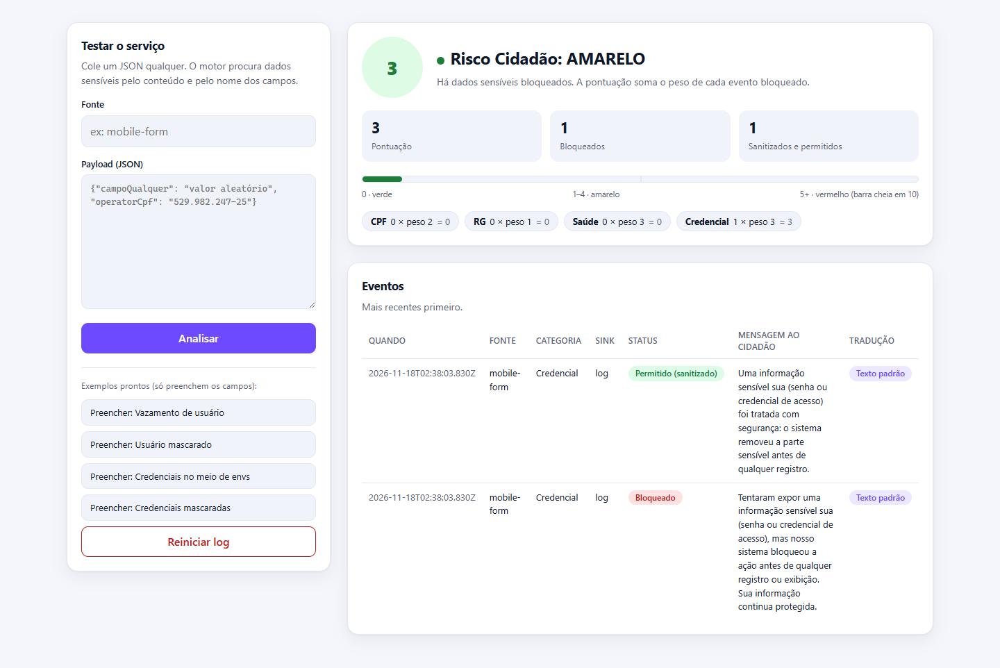

# Cybersecurity · Risco Cidadão

O painel acompanha o que acontece quando um formulário ou uma API recebe dados pessoais. Ele mostra o tipo de informação detectada, a tentativa de registro bloqueada e a mensagem para o cidadão após o tratamento.

**Herbert de Sousa Vilela · RM 555701** · [Equipe](../README.md#equipe) · [Rubrica](../docs/disciplinas/cybersecurity.md)

## Material entregue ao professor

[Baixar o PDF da entrega](docs-entrega/cybersecurity-entrega.pdf) · [Assistir ao vídeo entregue](video-demostrativo.mp4) · [Abrir a apresentação complementar](docs-entrega/apresentacao.pdf)



A captura acima é de uma execução complementar com credencial fictícia. O vídeo original usa o texto padrão disponível offline.

## Executar

Na pasta `cybersecurity/`, com Node 22.23 ou mais recente:

```bash
npm ci
npm test
npm start
```

Abra [o painel local](http://127.0.0.1:8090/dashboard). Escolha um exemplo e clique em **Analisar**. Compare os eventos do dado original e do dado mascarado. O botão de reinício limpa os eventos dessa sessão. Para uma demonstração no terminal, execute `npm run demo`.

## O que o código demonstra

| Etapa | Comportamento | Implementação |
| --- | --- | --- |
| Identificação de PII | Classifica CPF, RG, saúde e credenciais em dados sintéticos. | [Regras e parser](src/pii/) |
| Taint analysis | Acompanha o dado da entrada ao log e permite a saída após sanitização. | [Marca e saídas protegidas](src/taint/) |
| Tradução | Envia o diagnóstico técnico à Anthropic quando há chave configurada. Sem chave ou com provedor indisponível, o painel indica texto padrão. | [Tradutor](src/llm/translate.ts) |
| Painel | Cada bloqueio soma o peso da categoria. A partir de 1 o farol fica amarelo e a partir de 5, vermelho. | [Cálculo](src/risk/score.ts) · [Interface](src/dashboard/render.ts) |

Para a tradução generativa, configure `ANTHROPIC_API_KEY` no ambiente local. O prompt contém código, categoria e tipo de saída. A fonte informada pelo cliente só aparece nos eventos quando coincide com um identificador conhecido. Outras fontes válidas aparecem como `manual`.

O serviço de auditoria escuta em loopback e mantém os eventos em memória. `POST /api/cybersecurity/v1/analyze` recebe `{ source, payload }` e retorna os achados, o objeto mascarado, os eventos e o risco. As rotas `/events` e `/risk` desse prefixo permitem consultar o resultado. A auditoria usa [fixtures sintéticas](fixtures/requests/) e não coleta dados pessoais dos usuários do Sonora.
