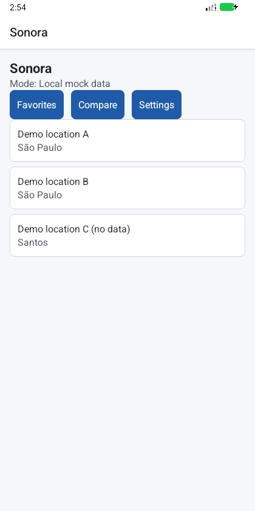
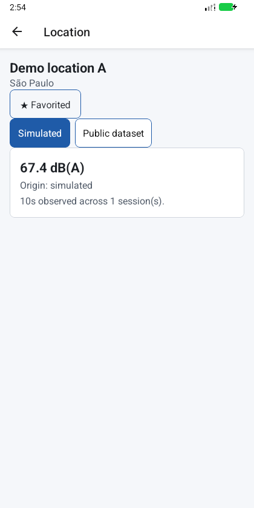
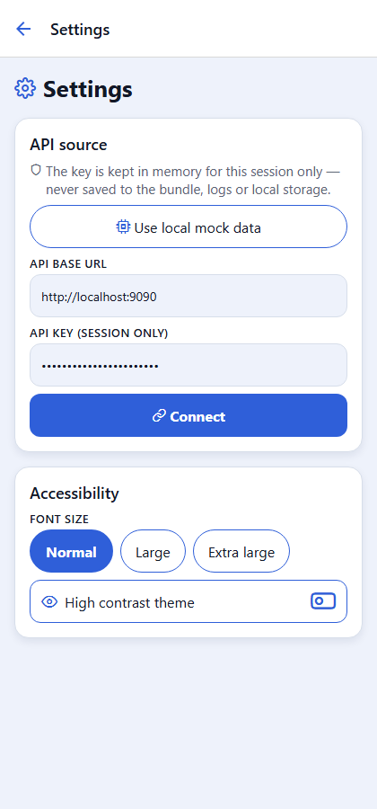
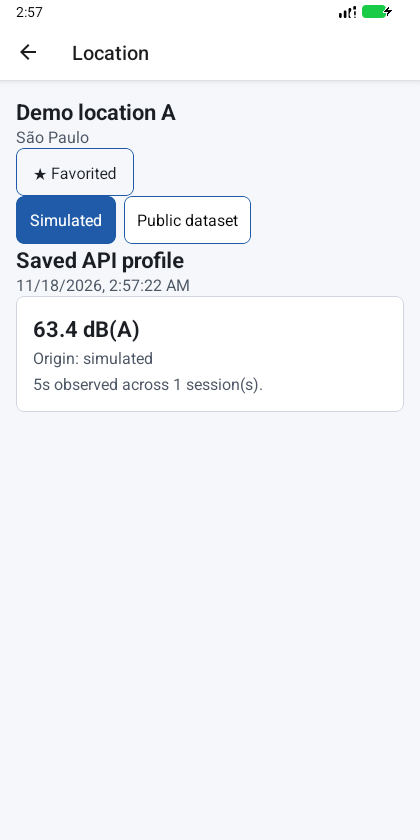

# Sonora — Mobile

**Consulta acústica, comparação de locais e favoritos no bolso do cidadão**

Documentação de entrega — Global Solutions CitizenTech
FIAP · Turma 3ESPV-2026 · Disciplina: Mobile Development
Repositório: [github.com/peguidotte/sonora/tree/main/mobile](https://github.com/peguidotte/sonora/tree/main/mobile)

---

## Ficha CitizenTech

| Item | Sonora |
| --- | --- |
| Território | São Paulo (SP). A demonstração usa locais selecionados e os dados públicos têm cobertura irregular. |
| Quem se beneficia | Quem está pesquisando um imóvel em São Paulo e quer entender o contexto acústico do entorno. |
| Problema | É difícil comparar a medição de ruído de dois locais antes de visitar ou escolher um imóvel. |
| Como funciona | O app consulta perfis acústicos do C#, exibe período, origem e cobertura e permite guardar favoritos. A demonstração também funciona com dados sintéticos. |
| Papel de cada parte | Wokwi simula medições. Java recebe e grava no PostgreSQL. C# consulta as views e calcula o perfil. Mobile apresenta os resultados e guarda favoritos e consultas em SQLite. |
| Indicador a medir | Percentual de consultas que encontram observações e tempo coberto pelas medições em cada recorte. |
| ODS | ODS 3, Saúde e Bem-estar, e ODS 11, Cidades e Comunidades Sustentáveis. |
| Repositório e integrantes | [Sonora no GitHub](https://github.com/peguidotte/sonora) · [Equipe](../README.md#equipe) |

---

## 1. Introdução e problemática

### 1.1 Introdução

Uma visita a um imóvel dura minutos. Nesses minutos ninguém descobre se aquela rua é silenciosa às 7h da manhã ou se vira um corredor de buzina às 18h. O Sonora existe para preencher essa lacuna: ele reúne observações de ruído de diferentes fontes e devolve, por local e horário, um contexto acústico que ajuda quem está escolhendo onde morar.

Este documento apresenta o componente **Mobile** do projeto: o aplicativo React Native que coloca esse contexto acústico na mão do cidadão. É pelo app — não pelo painel web nem pela API crua — que a pessoa comum consulta um local, compara dois endereços lado a lado e guarda os que importam para decidir com calma, depois da visita.

### 1.2 Problemática

Informação de ruído só é útil se chegar a quem decide, no momento em que decide — e esse alguém normalmente está no celular, na rua, sem paciência para interpretar um payload de API:

- o cidadão não sabe **de onde** veio o número que está vendo (sensor simulado? arquivo histórico público?) nem **quanto tempo** foi medido, e sem isso o dado vira ruído, não contexto;
- comparar dois endereços à mão — abrindo abas, anotando valores — é lento e sujeito a erro, especialmente se os períodos ou as origens dos dados não forem os mesmos;
- quem revisita a decisão depois (em casa, sem internet) precisa que o que já foi consultado continue disponível, com a data de quando foi obtido;
- parte do público não enxerga bem, não lê fonte pequena ou não consegue tocar em alvos apertados — um app que depende só de cor ou de texto miúdo exclui exatamente quem mais precisa de uma decisão informada.

Daí a pergunta que este componente responde:

> Como entregar, num app simples e acessível, a consulta e a comparação de contexto acústico por local — com a origem e a cobertura sempre visíveis, funcionando mesmo offline, sem nunca virar um veredito de conforto do imóvel?

### 1.3 Objetivos

A resposta é construída em quatro frentes, que correspondem ao que a disciplina de Mobile Development propõe (Global Solutions CitizenTech, PDF p. 34):

- **Consultar e comparar:** navegação completa entre locais, perfil acústico e comparação de dois endereços no mesmo período/origem/método.
- **Persistir no aparelho:** favoritos e cache de consultas em SQLite local, sobrevivendo ao fechar e reabrir o app, sem depender de rede.
- **Ser acessível de verdade:** escala de fonte, alto contraste, rótulos para leitor de tela e alvos de toque mínimos em todos os controles, não só nos principais.
- **Nunca inventar certeza:** todo estado sem dado, com dado parcial ou com erro de acesso é mostrado como tal — o app nunca estima o que não mediu nem ranqueia conforto.

---

## 2. A solução no contexto do Sonora

### 2.1 O produto

O Sonora oferece contexto acústico a quem compara onde morar e a plataformas imobiliárias que queiram integrar essa consulta. O app Mobile é a porta de entrada do cidadão: a aplicação que ele instala, abre e usa para resolver essa jornada — consultar, comparar, favoritar — sem precisar entender API, banco ou arquitetura por trás. O produto informa observações de ruído, período, fonte e cobertura; não garante conforto dentro de imóveis, silêncio contínuo nem conformidade legal, e não armazena áudio.

### 2.2 Quem recebe, grava e consulta

A arquitetura aprovada do Sonora tem quatro blocos principais, em torno de um PostgreSQL compartilhado:

| Componente                   | Papel                                                                                                                         |
| ---------------------------- | ----------------------------------------------------------------------------------------------------------------------------- |
| **SOA · Java**               | Recebe leituras IoT e importa arquivos públicos do NoiseCapture; valida, normaliza, deduplica e grava no PostgreSQL.          |
| **PostgreSQL**               | Observações, fontes, lotes e dispositivos. Dados reais públicos (`public_dataset`) e simulados (`simulated`) ficam separados. |
| **Sonora API · C#**          | Consulta o banco em somente leitura, calcula perfis acústicos e comparações e entrega dados legíveis por API.                 |
| **Mobile (este componente)** | Consulta a API Sonora por HTTPS: lista locais, mostra perfil acústico, compara e favorita.                                    |

### 2.3 Onde o Mobile entra

```
┌─────────────┐      ┌──────────────┐      ┌──────────────┐      ┌──────────────┐
│ ESP32/Wokwi │      │  SOA · Java  │      │ PostgreSQL   │      │ Sonora · C#  │
│ NoiseCapture│─────▶│  (ingestão)  │─────▶│ (views read) │◀─────│  (consulta)  │
└─────────────┘      └──────────────┘      └──────────────┘      └──────┬───────┘
                                                                         │ GET /api/sonora/v1/...
                                                                         │ X-Api-Key: acoustics:read
                                                                         ▼
                                                                 ┌───────────────┐
                                                                 │ Sonora Mobile │
                                                                 │ (este app)    │
                                                                 └───────┬───────┘
                                                                         │
                                                        SQLite local: favoritos + cache offline
```

O app **nunca** fala com o PostgreSQL nem com a ingestão Java — só com a API C# (`/api/sonora/v1`), e só em leitura. A única gravação que o Mobile faz é local, no SQLite do próprio aparelho (favoritos e cache de perfil), e não compartilha arquivo com nenhum outro backend.

> **Estado desta integração.** O adaptador HTTP está implementado e tipado conforme o OpenAPI (`contracts/openapi/csharp.openapi.json`) e foi verificado contra a API C# rodando localmente (`component.json` → `integrated.status: verified-local-emulator`). O modo padrão do app, e o único exigido para a entrega, é o mock local — nas mesmas formas do contrato — declarado como tal na tela inicial.

---

## 3. Como o app funciona

Expo Router organiza a navegação em cinco telas:

```
index (lista de locais)
  ├──▶ locations/[id]  → perfil acústico do local, origem, favoritar
  ├──▶ compare         → escolher Local A e Local B, comparar
  ├──▶ favorites       → locais salvos, persistem entre aberturas
  └──▶ settings        → fonte de dados (mock/API real), acessibilidade
```

Cada tela resolve uma etapa da jornada do cidadão descrita na ficha da disciplina: descobrir locais monitorados, entender o que um local específico mede, colocar dois lugares lado a lado antes de decidir, e guardar o que importa para rever depois, mesmo sem internet.

---

## 4. Arquitetura e organização do código

- `app/` — as cinco telas (Expo Router), uma por rota.
- `src/api/` — contrato único de dados: `client.ts` (tipo do adaptador), `mockClient.ts` (dados sintéticos nas formas do OpenAPI/fixtures) e `httpClient.ts` (chamada real); `types.ts` espelha o contrato.
- `src/domain/` — regras puras e testadas: `compare.ts` (compatibilidade de comparação, cobertura) e `period.ts` (janela de tempo).
- `src/storage/` — SQLite local: `favorites.ts`, `cache.ts` e `database.ts`.
- `src/accessibility/` — `AccessibilityContext.tsx`: escala de fonte e alto contraste, consumidos por toda a UI.
- `src/components/` — UI compartilhada: `ScreenContainer`, `ThemedText`, `Card`, `Chip`, `QueryStates` (carregando/vazio/erro/offline).
- `src/session/` — `SessionContext.tsx`: modo mock vs. integrado e a chave de API em memória.
- `src/theme.ts` — paleta normal/alto contraste, espaçamento, raio e sombra únicos para todo o app.

---

## 5. Decisões técnicas

- **Um adaptador, duas implementações.** `mockClient.ts` e `httpClient.ts` implementam a mesma interface e usam as mesmas formas do OpenAPI/fixtures; trocar de fonte na tela Settings não muda uma linha de tela.
- **Nunca ranking de conforto.** A comparação relata incompatibilidade (período/origem/método diferentes) ou os dois perfis lado a lado — nunca "local A é melhor que B". Decisão de produto, coberta por teste (`src/domain/compare.test.ts`).
- **Chave de API só em memória.** Fica no estado React da sessão; nunca é gravada em SQLite, log, bundle ou `AsyncStorage`. Fechar o app exige informá-la de novo — o custo de reduzir a superfície de vazamento de credencial.
- **Sem retry automático em 401/403.** Erro de autenticação é mostrado de forma compreensível; o app não tenta de novo sozinho nem expõe a chave na mensagem.
- **Offline é um estado de primeira classe, não uma falha.** Perfil já consultado fica em cache SQLite com a data de obtenção; sem rede, o app reaproveita o cache e avisa que está offline, em vez de travar ou mostrar erro genérico.
- **Acessibilidade no componente, não na tela.** Escala de fonte, tema de alto contraste e alvo de toque mínimo (48dp) vivem em `theme.ts`/`AccessibilityContext` e são herdados por `ThemedText`/`Card`/`Chip` — nenhuma tela precisa reimplementar a regra.

---

## 6. Consulta de perfil acústico

A tela de detalhe (`app/locations/[id].tsx`) cobre todos os estados possíveis de uma consulta real:

| Estado                         | O que o cidadão vê                                                                |
| ------------------------------ | --------------------------------------------------------------------------------- |
| Carregando                     | Indicador de progresso com rótulo lido por leitor de tela                         |
| Disponível                     | dB(A), origem (`simulated`/`public_dataset`) e cobertura do período               |
| `no_data`                      | Aviso explícito de que não há observação no período/origem pedidos — nunca `0 dB` |
| Erro de rede, com cache        | Banner "offline" com a data do último sucesso, seguido do último perfil conhecido |
| Erro de autenticação (401/403) | Mensagem compreensível, sem repetição automática nem exposição da chave           |

---

## 7. Comparação de dois locais

A tela `compare.tsx` exige que os dois lados usem o mesmo período, a mesma origem e o mesmo método de medição antes de mostrar qualquer número lado a lado (`src/domain/compare.ts`, com testes unitários). Quando essa condição não é satisfeita, o app explica o motivo da incompatibilidade em vez de comparar valores que não são comparáveis — e em nenhum caso produz uma nota ou ranking geral de conforto entre os dois locais.

---

## 8. Favoritos e cache offline (banco de dados)

SQLite local (`expo-sqlite`) guarda duas coisas, cada uma no seu próprio registro:

- **Favoritos** (`src/storage/favorites.ts`): locais marcados pelo cidadão, que persistem entre aberturas do app — comprovado reabrindo o Metro/app e revisitando a tela Favorites.
- **Cache do perfil acústico** (`src/storage/cache.ts`): a última resposta bem-sucedida por local/período, com a data de obtenção, usada automaticamente quando a API está inacessível.

Nenhum dos dois é compartilhado com outro backend; é um banco só do aparelho.

---

## 9. Acessibilidade

- Escala de fonte normal/grande/extra grande, ajustável na tela Settings e aplicada a todo texto via `ThemedText`.
- Tema de alto contraste (WCAG AA+), alternável a qualquer momento, sem perder nenhuma informação mostrada no tema normal.
- `accessibilityRole`, `accessibilityLabel` e `accessibilityState` em todo controle interativo — botões, chips de seleção, campos e estados de carregamento/erro.
- Alvo de toque mínimo de 48dp em todos os elementos tocáveis (`MIN_TOUCH_TARGET`).
- Nenhum estado depende só de cor: seleção, erro e disponibilidade sempre vêm acompanhados de ícone e/ou texto.

---

## 10. Capturas de tela

Capturadas com o visual atual, rodando o app no Expo web: 01–04 em modo mock local (sem backend); 05–06 com a tela Settings conectada a um stub HTTP local que serve as mesmas formas do OpenAPI, só para exercitar o fluxo "conectado" e o cache offline sem depender da API C# real rodando nesta máquina — não é evidência de integração real (ver [Pendências](#14-pendências)).

| Locais                                       | Perfil acústico                                          | Favoritos                                          |
| -------------------------------------------- | -------------------------------------------------------- | -------------------------------------------------- |
|  |  |  |

| Comparação                                                 | Conectado a um stub HTTP local                                        | Cache offline                                                              |
| ---------------------------------------------------------- | --------------------------------------------------------------- | -------------------------------------------------------------------------- |
|  |  |  |

---

## 11. Vídeo demonstrativo

**Link do vídeo (até 3 minutos, app rodando):** [https://www.youtube.com/shorts/h28uFAojPhM](https://www.youtube.com/shorts/h28uFAojPhM)

---

## 12. Como executar

### Versões

- Node 22, npm.
- Expo SDK 58, Expo Router 6, React Native 0.88.1, React 19.3.0.
- TypeScript 6.0 em modo `strict`.
- Testes: Jest + ts-jest.
- Build Android: Expo prebuild gerenciado + Gradle (Java 17), conforme [pipeline.json](../deploy/pipeline.json) e o [contrato das aplicações](../deploy/azure/README.md#contrato-das-aplicações).

### Instalação

Na raiz do clone:

```bash
cd mobile
npm ci --legacy-peer-deps
```

`--legacy-peer-deps` é necessário porque o suporte web do `expo-router` traz `@radix-ui/react-tabs`, que pede uma faixa de `react-dom` não declarada como dependência deste app (RN puro); sem a flag, `npm ci` recusa a resolução por peer dependency, mesmo sem afetar o app Android/iOS.

### Standalone (mock local)

Sem nenhum backend ativo, o app abre com dados sintéticos embutidos (`src/api/mockClient.ts`), nas mesmas formas do OpenAPI/`contracts/fixtures/*.json` (locations, noise-profile disponível e `no_data`). Esse modo é o padrão ao abrir o app e fica explícito na tela inicial ("Mode: Local mock data").

```bash
npx tsc --noEmit   # typecheck estrito
npx jest           # testes unitários (regras de comparação e cobertura)
npx expo start     # abre o Metro bundler; escanear com Expo Go ou emulador Android
```

Gerar e inspecionar o projeto Android nativo (o mesmo passo usado pela CI, sem executar o Gradle):

```bash
npx expo prebuild --platform android --clean --no-install
```

### Integrado (API C# real)

Sem reconstruir o app: na tela **Settings**, trocar para a aba de API, informar a **URL base** (`scheme://host:porta`, sem o prefixo do contrato) e a **chave X-Api-Key** de leitura (`acoustics:read`). A chave fica somente em memória da sessão (estado React), nunca é gravada em SQLite, log, bundle ou `AsyncStorage`. Fechar o app limpa a chave; é preciso informá-la de novo.

```text
API base URL: http://<host-do-C#>:8080
API key: <chave acoustics:read fornecida pelo operador>
```

Sem conexão (401/403/rede), o app nunca tenta retry automático: mostra mensagem compreensível (sessão inválida/sem escopo) ou, se já houver cache local daquela consulta, reaproveita o cache mostrando a data do último sucesso ("Offline — showing cached data from …").

### Validado nesta máquina

`npm ci --legacy-peer-deps`, `npx tsc --noEmit` e `npx jest` (7/7) sem erros; `npx expo prebuild --platform android --clean --no-install` gera o projeto nativo sem falhas. `npx expo-doctor` aponta 19/20 (três pacotes com patch mais novo disponível na mesma faixa semver; não bloqueia build nem execução).

---

## 13. Exigências e critérios da disciplina

Exigência do professor e tarefa coletada (PDF CitizenTech p. 34; íntegra na [ficha da disciplina](../docs/disciplinas/mobile.md)): entregar um app Expo funcional que resolva a jornada do cidadão, consumindo API ou mock e gravando em banco local, com interface simples e acessível. Entrega por GitHub com código, README (ficha + instruções + prints) e vídeo de até 3 minutos, enviado por um único integrante no Teams até 19/11, 23h55. Nota de 0 a 10 em seis critérios; pesos ainda não divulgados ([pendência registrada](../docs/01-contexto-e-requisitos.md#diferenças-e-pendências-dos-enunciados)).

| Entregável pedido                     | Onde está                                                                     |
| ------------------------------------- | ----------------------------------------------------------------------------- |
| Código do app organizado              | [Arquitetura e organização do código](#4-arquitetura-e-organização-do-código) |
| Ficha CitizenTech da disciplina       | [Ficha CitizenTech preenchida](#ficha-citizentech)                             |
| Instruções para rodar o app           | [Como executar](#12-como-executar)                                            |
| Prints das telas                      | [Capturas de tela](#10-capturas-de-tela)                                      |
| Vídeo até 3 minutos com o app rodando | [Vídeo demonstrativo](#11-vídeo-demonstrativo)                                |

| Critério da rubrica   | Onde avaliar                                                                                                               |
| --------------------- | -------------------------------------------------------------------------------------------------------------------------- |
| Telas e navegação     | [Como o app funciona](#3-como-o-app-funciona); [capturas](#10-capturas-de-tela)                                            |
| Consumo de dados      | [Consulta de perfil acústico](#6-consulta-de-perfil-acústico); adaptador único em [`src/api/client.ts`](src/api/client.ts) |
| Banco de dados        | [Favoritos e cache offline](#8-favoritos-e-cache-offline-banco-de-dados)                                                   |
| Acessibilidade        | [Acessibilidade](#9-acessibilidade)                                                                                        |
| Aderência ao problema | [Introdução e problemática](#1-introdução-e-problemática)                                                                  |
| Documentação          | Este README e a [ficha da disciplina](../docs/disciplinas/mobile.md)                                                       |

---

## 14. Pendências

- As capturas 05 e 06 usam um stub HTTP local no lugar da API C# real (ver [Capturas de tela](#10-capturas-de-tela)); valem como evidência de UI, não de integração.
- Build de APK de debug assinado é gerado pela CI (`delivery.yml`); não há publicação em loja nem assinatura de produção.

Mock permitido e declarado acima; não é evidência de integração real. Estado verificável em [`component.json`](component.json).

---

## 15. Equipe

Global Solution CitizenTech · Engenharia de Software · FIAP Paulista · 3ESPV 2026

| Integrante               | RM     |
| ------------------------ | ------ |
| Leonardo Correa de Mello | 555573 |
| Felipe Soares Xavier     | 556931 |
| Pedro Visconti Guidotte  | 556630 |
| Herbert de Sousa Vilela  | 555701 |
| Gabriel Figueira Flora   | 556476 |

Responsabilidades e branches completas no [README principal](../README.md#equipe).
