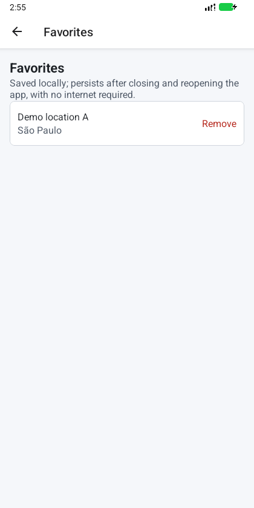
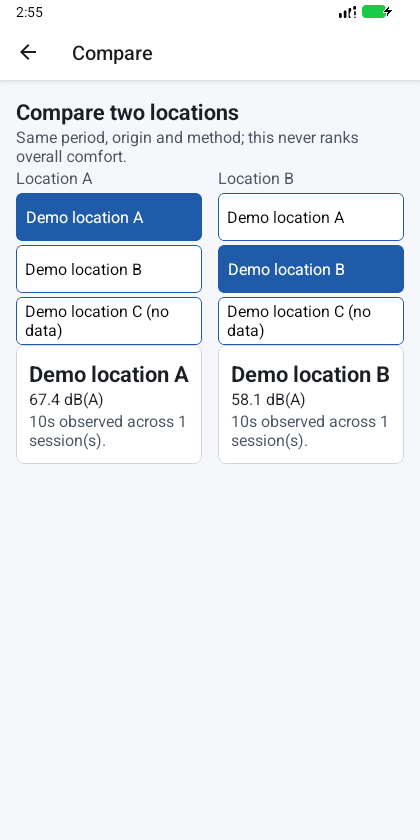

# Sonora Mobile

Consulte um local, compare perfis acústicos e salve favoritos no celular. O app usa React Native, TypeScript e Expo Router. SQLite guarda favoritos e consultas salvas no aparelho.

[Requisitos da disciplina](../docs/disciplinas/mobile.md) · [Equipe](../README.md#equipe)

## Ficha CitizenTech

| Item | Sonora |
| --- | --- |
| Território | São Paulo (SP). A demonstração usa locais selecionados e os dados públicos têm cobertura irregular. |
| Quem se beneficia | Quem está pesquisando um imóvel em São Paulo e quer entender o contexto acústico do entorno. |
| Problema | É difícil comparar a medição de ruído de dois locais antes de visitar ou escolher um imóvel. |
| Como funciona | O app consulta perfis acústicos do C#, exibe período, origem e cobertura e permite guardar favoritos. A demonstração também funciona com dados sintéticos. |
| Papel de cada parte | Wokwi simula medições. Java recebe e grava no PostgreSQL. C# consulta as views e calcula o perfil. Mobile apresenta os resultados e guarda favoritos e consultas em SQLite. |
| Indicador a medir | Percentual de consultas que encontram observações e tempo coberto pelas medições em cada recorte. |
| ODS | ODS 3, Saúde e Bem-estar, e ODS 11, Cidades e Comunidades Sustentáveis. |
| Repositório | [Sonora no GitHub](https://github.com/peguidotte/sonora) |

## Começar

Use Node.js 22. Para executar em Android, instale Java 17, Android SDK e um emulador ou conecte um aparelho.

```bash
cd mobile
npm ci
npm run android
```

O app abre em modo de demonstração com dados sintéticos. Na tela **Settings**, selecione a API e informe a URL base do C# e uma chave com escopo `acoustics:read`. A chave fica em memória e precisa ser informada de novo após fechar o app.

### Jornada de consulta

1. Abra um local e escolha a origem das medições. O perfil mostra cobertura e indica quando o período não tem dados.
2. Marque um local consultado como favorito. Se abrir esse favorito após reiniciar o app, o último perfil salvo da API aparece identificado com a data da consulta.
3. Na tela **Compare**, selecione dois locais. A comparação verifica período, origem e método de coleta.

## Prévia técnica em Android

[Vídeo do app em execução](https://github.com/peguidotte/sonora/releases/download/mobile-demo-v0.1.0/sonora-mobile-demo.mp4) · [APK da prévia técnica](https://github.com/peguidotte/sonora/releases/tag/mobile-demo-v0.1.0)

A aprovação visual da versão de entrega está pendente. Esta versão usa a última hora para a consulta e limita a comparação à origem simulada. O histórico de 2018 está disponível no [painel web](../linux/README.md#consultar-uma-medição-pública-no-painel).

Registro feito no emulador Android 37 com dados sintéticos. O vídeo mostra a consulta, a comparação e a reabertura de um favorito salvo em SQLite com a rede desligada.

| Consulta | Perfil | Favoritos | Comparação |
| --- | --- | --- | --- |
|  |  |  |  |

### Consulta à API real e reabertura offline

No mesmo emulador, conectamos o aplicativo ao C# com PostgreSQL descartável e consultamos uma observação de 63,4 dB(A). Depois de fechar o processo e remover a conexão, reabrimos o favorito. O app recuperou o mesmo perfil do SQLite com a data da consulta.

| Perfil recebido do C# | Perfil salvo reaberto sem conexão |
| --- | --- |
|  |  |

## Validação

```bash
npm run typecheck
npm test -- --runInBand
npx expo export --platform android
```

Para montar o APK no Android, execute `npx expo prebuild --platform android` e `./gradlew assembleRelease` a partir de `android/` (no Windows, `gradlew.bat assembleRelease`). A variante release inclui o bundle JavaScript e usa a chave de teste padrão do Expo para a demonstração. Esse também é o fluxo do [GitHub Actions](../.github/workflows/delivery.yml).
