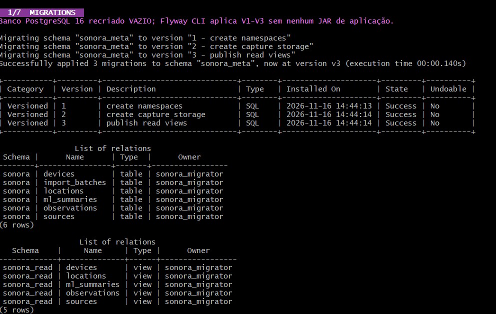
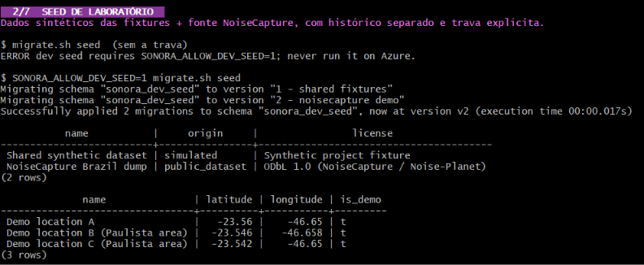
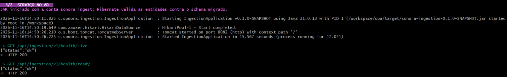
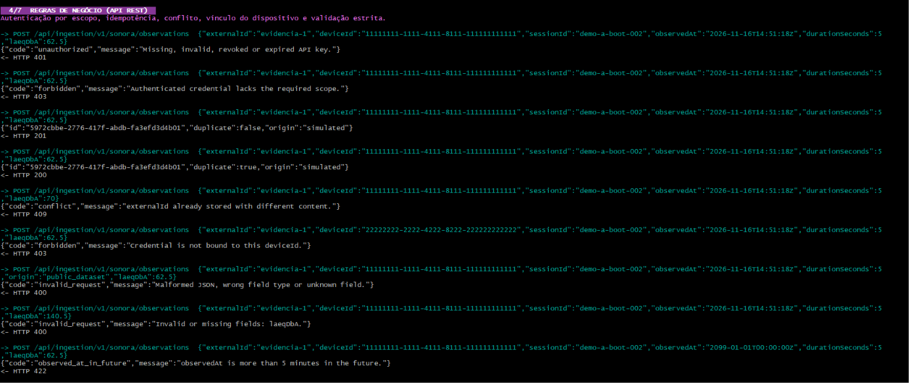
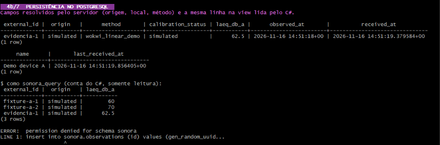
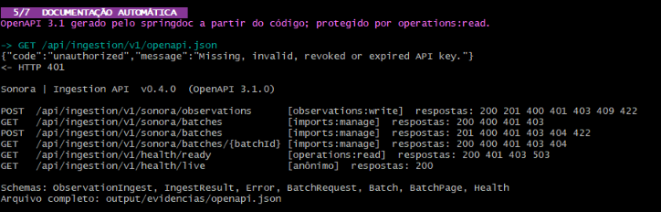
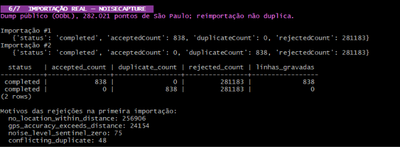
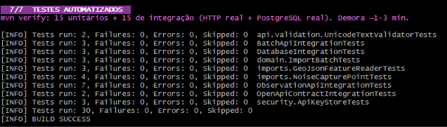

# Ingestão de medições · Java

[Executar localmente](#executar-localmente) · [Rotas](#rotas-apiingestionv1) · [Evidências](#evidências) · [Saúde do serviço na Azure](https://sonora-gs-58403f1647.centralus.cloudapp.azure.com/api/ingestion/v1/health/live)

Responsável: **Felipe Soares Xavier, RM556931**. [Equipe completa](../README.md#equipe): Leonardo Correa de Mello (RM555573), Felipe Soares Xavier (RM556931), Pedro Visconti Guidotte (RM556630), Herbert de Sousa Vilela (RM555701) e Gabriel Figueira Flora (RM556476).

[Especificação da matéria](../docs/disciplinas/soa.md) · [Arquitetura](../docs/arquitetura.md) · [Contratos](../contracts/README.md) · [Migrations](../database/README.md)

## O que este serviço faz

Sonora oferece contexto acústico por local e horário para quem compara onde morar. Este backend é a **porta de entrada dos dados**: recebe leituras do ESP32/Wokwi, importa arquivos públicos do NoiseCapture, valida, normaliza, deduplica e grava no PostgreSQL. A API C# (Leonardo) apenas lê as views publicadas; não há chamada HTTP Java → C#.

```text
ESP32/Wokwi ──POST /sonora/observations──┐
                                          ├─> Java (este serviço) ──grava──> PostgreSQL ──views sonora_read──> C#
NoiseCapture (arquivo) ──POST /sonora/batches┘
summary.json do ML ──comando local import-ml-summary──┘
```

## Mapa da rubrica

| Critério (pontos) | Onde está |
| --- | --- |
| Estruturação do domínio (3,0) | `domain/`: `Location`, `Source`, `Device`, `Observation`, `ImportBatch`, `MlSummary`, enums de origem/método/calibração/estado. Regras no domínio (faixas, retry idêntico, transições do lote) e serviços em `service/` e `imports/` |
| Conexão com banco (3,0) | Spring Data JPA + PostgreSQL com a conta `sonora_ingest` (sem DDL); `ddl-auto=validate` confere as entidades contra o schema real na inicialização; transações explícitas por trecho de importação |
| Migrations (1,5) | [`database/migrations`](../database/migrations): V2 (tabelas, CHECKs, chaves compostas de origem, menor privilégio) e V3 (views `sonora_read` para o C#), aplicadas pelo Flyway CLI independente do JAR; seed sintético separado em `database/seeds/dev` |
| Documentação automática (1,5) | springdoc gera `/api/ingestion/v1/openapi.json` a partir do código (rotas, DTOs, limites, erros e `x-required-scopes`); um teste confronta o documento gerado com [`soa.openapi.json`](../contracts/openapi/soa.openapi.json) |
| Testes automatizados (1,0) | 31 testes JUnit: 16 unitários e 15 de integração HTTP + PostgreSQL real (ver [Testes](#testes)) |

## Requisitos

PostgreSQL 16 preparado por [database/](../database/README.md) e JDK 21 + Maven 3.9 (ou apenas Docker, ver abaixo). Nenhuma dependência de nuvem ou da API C#.

## Executar localmente

Na raiz do clone. Banco **descartável** com as contas públicas de laboratório `ci-*` (nunca usá-las na Azure):

```bash
python database/prepare.py
docker compose -p sonora-local -f database/compose.yaml up -d --wait postgres
docker compose -p sonora-local -f database/compose.yaml run --rm migrate
docker compose -p sonora-local -f database/compose.yaml run --rm -e SONORA_ALLOW_DEV_SEED=1 migrate seed   # opcional
```

Credenciais locais fora do Git (`output/` é ignorado). Este Python gera uma chave de operador (importações/operação) e uma de dispositivo vinculada ao `deviceId` do seed, gravando somente o SHA-256 no arquivo do serviço:

```python
from pathlib import Path
import hashlib, json, secrets
dev = Path("output/dev"); dev.mkdir(parents=True, exist_ok=True)
keys = []
for name, scopes, device in (("soa-operator", ["imports:manage", "operations:read"], None),
                             ("soa-device-demo-a", ["observations:write"], "11111111-1111-4111-8111-111111111111")):
    key = secrets.token_urlsafe(32)
    (dev / f"{name}.key").write_text(key, encoding="utf-8")
    entry = {"id": name, "sha256": hashlib.sha256(key.encode()).hexdigest(), "scopes": scopes}
    if device: entry["deviceId"] = device
    keys.append(entry)
(dev / "soa-keys.json").write_text(json.dumps({"keys": keys}), encoding="utf-8")
```

Com JDK 21 e Maven (PowerShell):

```powershell
$env:SONORA_DB_PASSWORD = 'ci-ingest-only'
$env:SONORA_KEYS_FILE = "$PWD/output/dev/soa-keys.json"
$env:SONORA_IMPORTS_FILE = "$PWD/output/dev/imports.json"
mvn -B -f soa/pom.xml verify
java -jar soa/target/sonora-ingestion-0.1.0-SNAPSHOT.jar
```

Somente com Docker (sem instalar Java/Maven), usando a rede do Compose:

```bash
docker run --rm --network sonora-local_default -v "$PWD:/workspace" -v sonora-m2:/root/.m2 -w /workspace \
  -e SONORA_DB_HOST=postgres -e SONORA_DB_PORT=5432 -e SONORA_DB_PASSWORD=ci-ingest-only \
  maven:3.9-eclipse-temurin-21 mvn -B -f soa/pom.xml verify
```

### Configuração

| Variável | Padrão | Uso |
| --- | --- | --- |
| `SONORA_DB_HOST` / `SONORA_DB_PORT` / `SONORA_DB_NAME` | `127.0.0.1` / `55432` / `sonora` | PostgreSQL (Azure: 5432 interno) |
| `SONORA_DB_USER` / `SONORA_DB_PASSWORD` | `sonora_ingest` / sem padrão | Conta de runtime; nunca a migradora |
| `SONORA_HTTP_HOST` / `SONORA_HTTP_PORT` | `127.0.0.1` / `8082` | Atrás do proxy HTTPS |
| `SONORA_KEYS_FILE` | sem padrão (tudo 401) | `{"keys":[{id, sha256, scopes[], deviceId?, expiresAt?, revoked?}]}` |
| `SONORA_IMPORTS_FILE` | sem padrão (todo fileId 404) | Arquivos permitidos; modelo em [`imports.example.json`](imports.example.json) |

Os dois arquivos são relidos a cada requisição: remover, revogar (`"revoked": true`) ou expirar (`expiresAt`) uma chave vale na hora. Caminhos relativos do catálogo partem da pasta do próprio catálogo. `SPRING_DATASOURCE_*` e `SERVER_ADDRESS/PORT` têm precedência quando presentes.

## Rotas (`/api/ingestion/v1`)

| Método e rota | Escopo | Respostas |
| --- | --- | --- |
| `GET /health/live` | anônimo | 200 |
| `GET /health/ready` | `operations:read` | 200 banco ok · 503 indisponível |
| `GET /openapi.json` | `operations:read` | documento OpenAPI 3.1 gerado |
| `POST /sonora/observations` | `observations:write` + chave vinculada ao `deviceId` | 201 criado · 200 retry idêntico · 400 · 401 · 403 · 409 conflito · 422 data futura |
| `POST /sonora/batches` | `imports:manage` | 201 com status/contadores · 400 · 404 fileId desconhecido · 422 arquivo indisponível |
| `GET /sonora/batches?page&pageSize` | `imports:manage` | 200 (mais recentes primeiro, pageSize 1–100) |
| `GET /sonora/batches/{batchId}` | `imports:manage` | 200 · 400 · 404 |

Exemplo com o dispositivo do seed:

```bash
curl -i -X POST http://127.0.0.1:8082/api/ingestion/v1/sonora/observations \
  -H "X-Api-Key: $(cat output/dev/soa-device-demo-a.key)" -H "Content-Type: application/json" \
  -d '{"externalId":"demo-1","deviceId":"11111111-1111-4111-8111-111111111111","sessionId":"demo-a-boot-002","observedAt":"2026-11-16T15:00:00Z","durationSeconds":5,"laeqDbA":62.5}'
```

## Regras implementadas

- **Autenticação antes do corpo**: sem chave/chave inválida, revogada, expirada ou `mock-*` → 401; sem escopo → 403. Chave de dispositivo só grava para o próprio `deviceId`; dispositivo desabilitado ou não cadastrado → 403. Rota sem política declarada é negada.
- **Origem nunca vem do cliente**: local, fonte, origem (`simulated`), método e calibração saem do cadastro do dispositivo. Um campo extra como `"origin"` é rejeitado (400); o banco também impede origem diferente da fonte (chave composta `source_id, origin`).
- **Validação estrita**: JSON sem campos desconhecidos, sem chaves duplicadas e sem coerção (`"62.5"` não vira número). `laeqDbA` 0–140, `durationSeconds` em (0, 3600], `observedAt` UTC com `Z`, até microssegundos e no máximo 5 min no futuro. Textos medidos em caracteres Unicode, como o `maxLength` do contrato e o `varchar(128)` do banco; nada é truncado.
- **Idempotência**: `source_id + external_id` é único. Retry idêntico → 200 `duplicate=true` com o mesmo `id`; mesmo id com conteúdo diferente → 409.
- **Importação**: o cliente envia só `fileId`; caminho, fonte e raio ficam no catálogo do servidor. Leitura em streaming; cada trecho de 500 pontos é gravado na mesma transação que avança os contadores (`acceptedCount` = linhas commitadas). Pontos só são associados ao local cadastrado mais próximo a até 50 m; coordenadas nunca são deslocadas e a trajetória não é armazenada (só a distância ao local). Arquivo inexistente → 422 sem lote; arquivo malformado ou alterado durante a leitura → lote `failed`, mantendo os contadores do que já foi commitado.
- **Regras do NoiseCapture** (rejeitados e contabilizados por motivo em `import_batches.errors`): nível exatamente 0 (sentinela), nível fora de 0–140, precisão do GPS ausente ou maior que o raio, data futura, nenhum local a até 50 m e o mesmo segundo da mesma trilha com leitura diferente (o primeiro prevalece). Cada ponto vira uma observação `noisecapture_1s` de 1 s, `public_dataset`, calibração `unknown`.
- **Menor privilégio no banco**: o runtime não altera observações nem resumos ML (sem UPDATE/DELETE), só atualiza `devices.last_received_at` e não tem DDL.

## Importar o dump público do NoiseCapture

Fonte: [NoiseCapture](https://noise-planet.org/noisecapture_exploit_data.html), [Brazil.zip](https://data.noise-planet.org/dump/Brazil.zip), licença ODbL. O arquivo fica fora do Git (`output/`).

1. Baixar o ZIP e extrair `Brazil_São Paulo_São Paulo.points.geojson` como `output/noisecapture/sao-paulo.points.geojson`.
2. Copiar `soa/imports.example.json` para `output/dev/imports.json` e aplicar o seed (cria a fonte e os locais de demonstração B e C).
3. `POST /sonora/batches` com `{"fileId":"noisecapture-sp-2026-11-08"}` e a chave de operador.

Referência medida em 16/11/2026 com o ZIP de SHA-256 `540aef97…181df9aa` (o mesmo de [ml/dados](../ml/dados/README.md)): dos 282.021 pontos, 838 foram aceitos (403 no local B e 435 no C, todos a até 50 m) e 281.183 rejeitados por regra (256.906 sem local a até 50 m, 24.154 com GPS impreciso, 75 sentinelas zero e 48 leituras conflitantes do mesmo segundo). Uma segunda importação gravou 0 e contou 838 duplicatas. Os locais B e C são **de demonstração**, posicionados onde o recorte tem pontos; não representam cobertura do bairro.

## Resumo do ML (comando administrativo)

```bash
java -jar soa/target/sonora-ingestion-0.1.0-SNAPSHOT.jar import-ml-summary ml/output/summary.json
```

Valida o arquivo pelo [schema compartilhado](../contracts/schemas/ml-summary.schema.json) (copiado de `contracts/` no build, sem duplicação) e grava em `ml_summaries`; a view publica somente o mais recente. Não executa notebook nem modelo. Saída 0 = importado ou já importado; 1 = rejeitado (schema, fixture sintética ou mesma versão/dataset com conteúdo diferente); 2 = uso/arquivo/banco. A fixture do contrato é recusada; `--allow-fixture` existe só para laboratório.

## Testes

`mvn -B -f soa/pom.xml verify` executa 31 testes. Os 15 de integração rodam quando `SONORA_DB_PASSWORD` está definida e o banco foi migrado; sem banco aparecem como **pulados**, nunca aprovados. Usam IDs e coordenadas aleatórios, mas gravam dados que o runtime não pode apagar: usar somente banco descartável.

| Classe | Verifica |
| --- | --- |
| `ObservationApiIntegrationTests` | 401/403 antes do corpo, 201→200→409, campos resolvidos no servidor, limites no valor exato e acima, tipos estritos, campo `origin` recusado, UTC/futuro/microssegundos, Unicode no limite sem truncamento, vínculo/cadastro do dispositivo |
| `BatchApiIntegrationTests` | Contadores = linhas commitadas, cada motivo de rejeição, reimportação idempotente, 404/422 sem lote, arquivo truncado, com conteúdo após o JSON ou de outro tipo → `failed`, caminho no corpo recusado, paginação |
| `OpenApiContractIntegrationTests` | Documento gerado x contrato: rotas, operationIds, escopos, códigos de resposta, campos obrigatórios e `maxLength` |
| `DatabaseIntegrationTests` | Privilégios reais de `sonora_ingest`, CHECKs/chaves compostas, importação ML idempotente |
| Unitários | Leitor GeoJSON em streaming (tipo FeatureCollection e nada após o documento), regras de ponto e associação a 50 m, Unicode, chaves (hash, revogação, expiração, mock), estados do lote |

Na CI, `deploy/pipeline.py package soa` executa o mesmo `mvn verify` contra o PostgreSQL migrado e `tools/check_database_compatibility.py` confere contratos x catálogo real (41 campos, sem relações pendentes). Resultados de execução e prints ficam no PR.

## Implantação (handoff para Linux/deploy)

O provisionamento ([Linux](../linux/README.md)) prepara o ambiente e documenta as credenciais de serviço. Para uma instalação nova, configure, além de `SONORA_DB_*` e `SONORA_KEYS_FILE`:

1. **`SONORA_IMPORTS_FILE`** no `soa.env`, apontando para um catálogo fora do Git (ex.: `/etc/sonora/soa-imports.json`), no formato de [`imports.example.json`](imports.example.json) com `path` **absoluto** do dataset (ex.: `/var/lib/sonora/imports/sao-paulo.points.geojson`). Sem essa variável o serviço sobe, mas todo `fileId` responde 404 (falha fechada).
2. **Dataset legível pelo usuário do serviço Java** (arquivo regular, sem link simbólico; somente leitura basta). Baixar de `https://data.noise-planet.org/dump/Brazil.zip`, conferir o SHA-256 e extrair o arquivo `Brazil_São Paulo_São Paulo.points.geojson`.
3. **Chaves**: uma de operador (`imports:manage`, `operations:read`) e uma por dispositivo Wokwi (`observations:write` + `deviceId`), só com hash no arquivo do serviço.
4. **Dados de referência** (locais, fontes e dispositivos): as migrations não os cadastram e o seed de laboratório **não** vai para a Azure. Inserir com a conta `sonora_migrator`, depois das migrations, com os valores escolhidos pela equipe:

```sql
INSERT INTO sonora.sources (id, name, source_url, snapshot_date, license, origin, limitations)
VALUES ('<uuid>', 'NoiseCapture Brazil dump', 'https://data.noise-planet.org/dump/Brazil.zip', DATE '<data do download>',
        'ODbL 1.0 (NoiseCapture / Noise-Planet)', 'public_dataset', '["Crowdsourced smartphone measurements; calibration unknown."]')
ON CONFLICT (id) DO NOTHING;
INSERT INTO sonora.locations (id, name, city, latitude, longitude, is_demo)
VALUES ('<uuid>', '<nome do local>', 'São Paulo', <lat>, <lon>, <true|false>) ON CONFLICT (id) DO NOTHING;
-- Dispositivo Wokwi: exige uma fonte com origin='simulated' para o mesmo source_id.
INSERT INTO sonora.devices (id, location_id, source_id, name, method, calibration_status)
VALUES ('<uuid do deviceId da chave>', '<uuid do local>', '<uuid da fonte simulada>', '<nome>', 'wokwi_linear_demo', 'simulated')
ON CONFLICT (id) DO NOTHING;
```

`ON CONFLICT DO NOTHING` torna o bootstrap reexecutável no reprovisionamento. Não há rota HTTP de cadastro (fora do contrato).

## Evidências

Capturas geradas pelo roteiro [`evidencias/gerar-evidencias.sh`](evidencias/gerar-evidencias.sh), que recria o banco vazio e executa cada etapa pausando para o print (`bash soa/evidencias/gerar-evidencias.sh` na raiz do clone; requer Docker e Python 3).

| # | Rubrica | O que a imagem mostra |
| --- | --- | --- |
| 1 | Migrations | Banco vazio → V1, V2 e V3 aplicadas pelo Flyway; tabelas `sonora` e views `sonora_read` |
| 2 | Migrations | Seed recusado sem a trava e aplicado com ela, em histórico separado |
| 3 | Banco | Serviço iniciado com `sonora_ingest`; Hibernate validou o schema; `ready` com banco ok |
| 4 | Domínio / REST | 401, 403, 201, 200 (retry), 409, 403 (outro dispositivo), 400 (`origin`), 400 (faixa), 422 (futuro) |
| 5 | Banco | Linha gravada com origem/método resolvidos no servidor; view lida pelo C#; escrita negada à conta do C# |
| 6 | Documentação | OpenAPI 3.1 gerado: rotas, escopos e respostas; 401 sem chave |
| 7 | Domínio / Banco | Importação real do NoiseCapture: 838 aceitos, reimportação com 838 duplicatas, motivos das rejeições |
| 8 | Testes | `mvn verify` sem falhas (captura feita com 30 testes; o teste de raiz GeoJSON veio depois da revisão) |










## Limites

- Wokwi gera nível **simulado**, sem calibração física; NoiseCapture é medição colaborativa de smartphone com calibração desconhecida. As origens ficam separadas e nunca são agregadas juntas.
- Importação síncrona: o arquivo da cidade leva cerca de 10 s localmente. Duas importações simultâneas do mesmo arquivo podem fazer uma delas terminar `failed` por conflito de unicidade, sem duplicar dados.
- Cadastro de locais, fontes e dispositivos em produção não tem rota HTTP (fora do contrato); no laboratório vem do seed. A escolha dos locais reais do produto é decisão da equipe.
